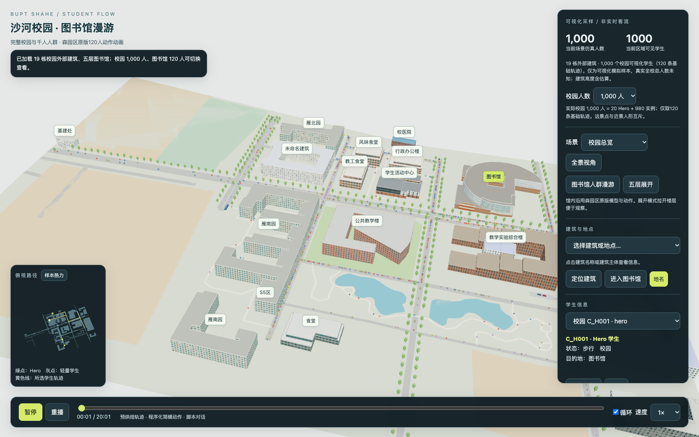
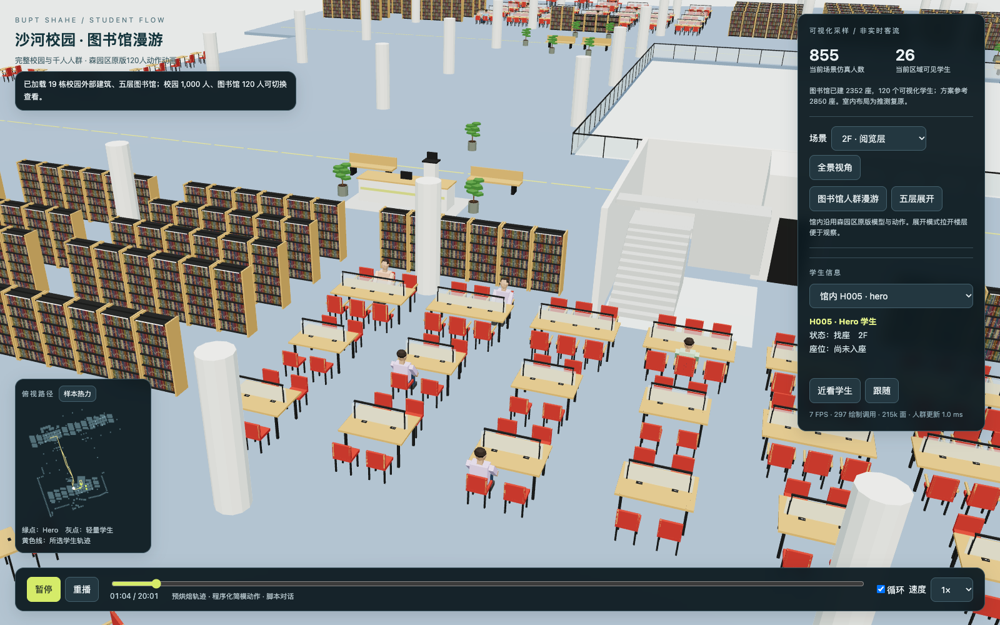
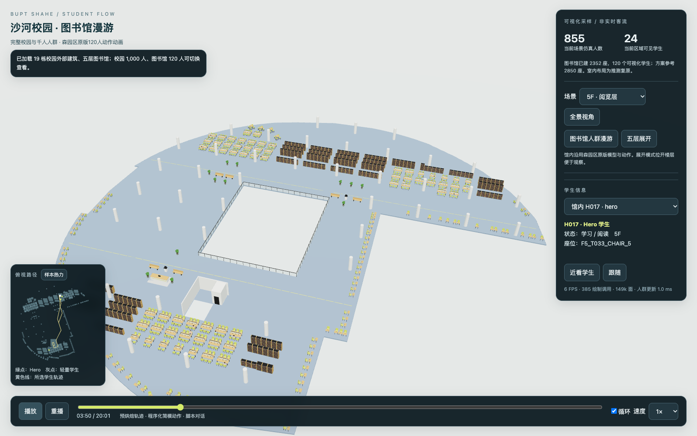
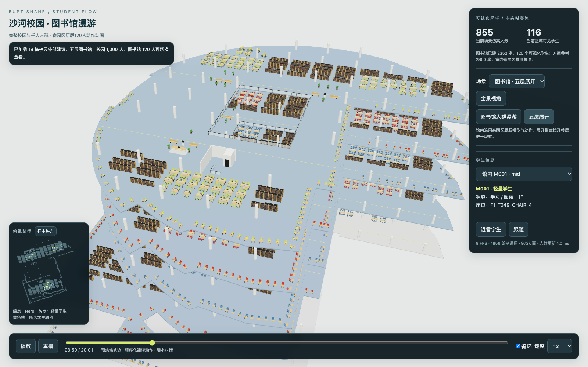
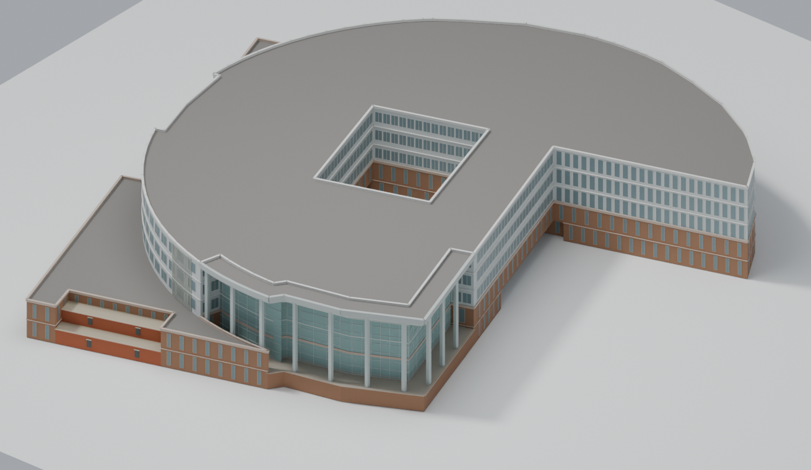
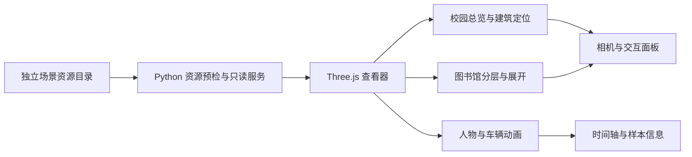

<div align="center">

<p><strong>BUPT SHAHE · CAMPUS DIGITAL TWIN</strong></p>

<h1>北邮沙河校园数字孪生</h1>

<p>从校园总览，到图书馆里的一次漫游。</p>

<p>校园建模 · 五层室内空间 · 人群与车辆回放 · 浏览器交互</p>

<p>
  <a href="#场景预览">场景预览</a> ·
  <a href="#快速开始">快速开始</a> ·
  <a href="#技术实现">技术实现</a> ·
  <a href="#验证与完成状态">验证与完成状态</a>
</p>

<p><code>Three.js 0.180.0</code> <code>Python 3.10+</code> <code>glTF 2.0 / GLB</code> <code>MIT · 源码</code></p>



<p><sub>本地查看器实际截图。画面中的人物为模拟样本，人数与状态不代表真实在校人员或实时客流。</sub></p>

</div>

## 项目概览

本项目以北京邮电大学沙河校区为背景，将校园建筑与道路、五层图书馆、人物动作和车辆动画组织到同一个浏览器场景中。既可以从全校视角观察空间布局，也可以进入图书馆，逐层查看阅览空间、靠近某个人物，并通过时间轴观察其位置与状态的变化。

项目关注的不只是“把模型显示出来”，还包括一条完整的观察路径：**校园总览 → 定位图书馆 → 进入楼层 → 选择人物 → 近景跟随 → 回放与返回校园**。模型、轨迹、相机与界面在这条路径中共同工作。

当前开源实现是基于 Three.js 的**本地场景查看器与预设动画回放系统**。它采用独立场景资产与本机只读服务，适合研究三维场景组织、人物回放、分层展示和资产加载。项目尚未接入实时感知数据，也未实现自主行为、路径避碰或交通决策。

| 校园尺度 | 建筑尺度 | 人物尺度 | 运行方式 |
| :---: | :---: | :---: | :---: |
| 120／1,000 人两档样本 | 图书馆 1F—5F | 点选、状态、近看与跟随 | 本机 Python + 桌面浏览器 |

> **运行前请先准备资产。** 仓库提供查看器源码、检查工具和展示截图，**不提供校园 GLB 模型及运行 JSON**。克隆源码后，需要另行取得有权使用的 12 个资源文件才能显示完整场景。源码测试与隐私检查可以独立运行。

## 场景预览

上方校园主图与本节三张图片均来自既有版本的本地浏览器实际运行记录。它们展示对应资产与界面下的观察结果；页面中的帧率来自当时的验收环境，不作为目标设备的性能承诺。

### 01 · 从全校布局进入建筑

首页总览把建筑、道路、地点标签和人物放在同一空间中。点击建筑名称或主体可以查看信息，再按“定位建筑”调整相机；图书馆提供独立入口。校园人物支持 120 人基线与 1,000 人模式，小地图辅助理解当前观察位置与所选样本路线。

上方主图展示校园千人模式。该模式复用基础路线并确定性错开时间；人群规模用于可视化观察，不意味着存在 1,000 条独立决策轨迹。

### 02 · 到图书馆里看人物与空间



馆内采用原人物 GLB 的动画片段，界面通过独立事件数据展示楼层、状态和座位信息。可以从约 60 秒的二层行走片段进入观察，再选择人物进行近看与跟随。书架、桌椅、柱网、楼梯与角色共同形成室内场景，而不是在静态平面图上叠加一个移动标记。

### 03 · 单层筛选与整馆展开

<table>
<tr>
<td width="50%"></td>
<td width="50%"></td>
</tr>
<tr>
<td align="center"><strong>单层观察</strong><br><sub>聚焦一个楼层的布局、家具与人物</sub></td>
<td align="center"><strong>五层展开</strong><br><sub>比较楼层结构与空间组织</sub></td>
</tr>
</table>

楼层切换同时影响显示对象与相机取景。展开模式额外拉开楼层间距，便于观察整馆关系；这个间距属于展示逻辑，**不能用于读取真实建筑层高**。

## 核心功能

| 模块 | 可以做什么 | 实现与边界 |
| --- | --- | --- |
| 校园总览 | 旋转、缩放、平移，定位建筑，显示地点标签 | 使用既有校园模型与空间数据；部分高度含估算 |
| 校园人群 | 切换 120／1,000 人，选择样本并跟随 | 基础轨迹复用与时间错位；没有自主决策与避碰 |
| 图书馆 | 1—5 层筛选、五层展开、进入人物漫游 | 既有资产为五层；室内布局含推测 |
| 馆内人物 | 播放原 GLB 动作，查看状态、座位和所属楼层 | 120 个样本；可见数量随时刻和楼层变化 |
| 车辆回放 | 查看行驶与停放车辆 | 既有资产为 10 辆行驶、2 辆停放；采用模型动画周期 |
| 时间控制 | 播放／暂停、拖动、重播、倍速与循环 | 人物时间范围来自输入数据，车辆使用自身动画周期 |
| 辅助观察 | 小地图、所选人物路线、馆内样本热力、运行统计 | 热力反映样本分布；性能需在目标设备实测 |

校园样本与馆内样本当前没有贯通的连续身份旅程；不能将场景切换解释为同一个真实学生从校门走到座位的全过程。

## 建模与场景组织



*建模阶段的离线渲染，展示图书馆外壳与内院关系。它不是浏览器运行截图，材质与照明效果也不等同于实时渲染。*

场景按三个层次组织：校园模型负责建筑体量、道路与总体布局；图书馆楼层模型负责静态室内空间；人物与车辆模型负责动作回放。通过这种分工，查看器可以在校园尺度与人物尺度之间切换，也可以单独控制楼层显示与动画时间。

Blender 在项目实践中承担模型与动画的制作、组织及导出，运行端则读取导出的 GLB 和事件 JSON。本仓库保留的是**查看与验证部分**，没有提供 Blender 完整生成链；无法仅凭克隆源码自动重新生成整套校园模型。

## 快速开始

### 1. 获取源码

需要 **Python 3.10 或更新版本**，以及支持 **WebGL2** 的桌面浏览器。服务端只使用 Python 标准库；Three.js 与所需 addons 已随源码提供，查看器运行无需 Node、npm 或在线 CDN。

```sh
git clone https://github.com/bosprimigenious/bupt-shahe-campus-digital-twin.git
cd bupt-shahe-campus-digital-twin
```

### 2. 准备独立资源目录

将合法取得的场景资源放在仓库之外。`--asset-root` 指向**包含 `outputs/` 的根目录**，不是某个 GLB 文件，也不是 `outputs/` 自身。

```text
scene-resources/
└── outputs/
    ├── campus_student_flow/
    │   ├── campus_data.json
    │   ├── agents.json
    │   ├── Campus_Exterior.glb
    │   └── Campus_Vehicles_Animated.glb
    └── student_flow/
        ├── agents.json
        ├── layout.json
        ├── Students_Animated.glb
        ├── Library_Floor_1.glb
        ├── Library_Floor_2.glb
        ├── Library_Floor_3.glb
        ├── Library_Floor_4.glb
        └── Library_Floor_5.glb
```

共 **4 个 JSON、8 个 GLB**。文件映射、坐标、静态楼层与动画片段的具体约定见[场景资产契约](docs/assets.md)。当前实现沿用该资源结构，不会自动适配任意校园数据或任意 GLB。

### 3. 预检并启动

把下面的示例路径替换为实际资源根目录：

```sh
python3 scripts/serve.py --asset-root /path/to/scene-resources --check-only
python3 scripts/serve.py --asset-root /path/to/scene-resources --open
```

预检成功时输出：

```text
PASS: all 12 allowlisted JSON/GLB assets satisfy the input contract.
```

预检失败会列出具体资源并拒绝启动。它检查输入结构、嵌入资源及必要动画片段；比例、人物贴地和实际观看效果仍需打开场景检查。

服务默认使用 `http://127.0.0.1:8768/`。`--open` 会自动进入图书馆二层人物漫游；若想先看校园总览，打开：

```text
http://127.0.0.1:8768/?count=1000&floor=0&paused=0
```

终端需要保持运行，按 `Ctrl+C` 停止。端口占用时添加 `--port 8769`，并使用终端打印的新地址。服务固定绑定本机回环地址，只提供查看器与清单中的 12 个资源文件，不开放资源目录列表，也不改写原模型。

## 操作与观察路径

建议第一次按下面的顺序体验：

1. **看校园**：选择“校园总览”，比较 120 人与 1,000 人模式，点击标签查看信息，再按“定位建筑”调整视角。
2. **进图书馆**：点击“图书馆人群漫游”，从二层行走片段开始观察人物与家具的关系。
3. **切换楼层**：依次选择 1F—5F，再用“五层展开”比较整馆结构。
4. **选一个人**：点选人物或从学生列表选择，查看状态、路线，使用“近看学生”或“跟随”。
5. **检查回放**：暂停并拖动时间轴，观察位置变化，再检查播放、循环与返回校园。

| 输入／控件 | 作用 |
| --- | --- |
| 鼠标左键拖动 | 旋转视角 |
| 鼠标右键拖动 | 平移视角 |
| 鼠标滚轮 | 缩放 |
| 全景视角 | 返回当前场景的整体观察位置 |
| 场景下拉框 | 切换校园总览与图书馆楼层 |
| 时间轴与倍速 | 调整回放时间和速度 |
| 小地图“样本热力” | 查看馆内样本分布；小窗口下小地图会隐藏 |

可见人数随时间与楼层变化。未入馆、已离馆或位于其他楼层的样本，不应一直出现在当前视图中。

## 技术实现

### 数据与渲染链路



| 输入 | 运行端职责 |
| --- | --- |
| 校园 JSON | 建筑与道路信息、路线采样、样本状态 |
| 馆内 JSON | 楼层、座位、事件与人物选中信息 |
| 校园／楼层 GLB | 校园外部体量与静态室内模型 |
| 人物／车辆 GLB | 通过 `AnimationMixer` 播放原始动画 |

**坐标约定。** 轨迹 JSON 使用 Blender 的 Z-up 坐标，查看器将其转换为 `(x, z, -y)`；GLB 已使用 glTF 的 Y-up 坐标，不能重复应用转换。馆内模型与轨迹使用同一校园偏移，展开间距只在显示时叠加。

**人物与动画。** 人物和车辆 GLB 需要名为 `_defaultAnim_` 的动画片段。馆内人物由原 GLB 播放，不能再叠加带静态人物的楼层快照，否则会重复显示。界面的“学习”“行走”等文字来自事件数据，判断动作是否正确仍需观察实际模型位移。

**人群规模。** 千人模式在基础路径上确定性错开时间，并采用远景点与近景人形的互斥显示。它扩展的是可视化样本规模，不会生成独立的行为决策。

### 仓库结构

```text
.
├── web/
│   ├── index.html          # 页面、控件与样式
│   ├── viewer.js           # 场景、动画、相机与选中逻辑
│   ├── crowd_math.mjs      # 确定性人群描述与路径采样
│   └── vendor/three/       # 本地 Three.js 与 addons
├── scripts/
│   ├── serve.py            # 资源预检与本机只读服务
│   └── audit_public.py     # 工作树与 Git 历史隐私检查
├── tests/                  # 服务、隐私检查与浏览器验收
├── docs/
│   ├── assets.md           # 运行资源契约
│   ├── public-release.md   # 发布范围与检查方法
│   └── images/             # 经检查的 README 展示图片与摘要清单
├── NOTICE.md               # 第三方声明与展示素材边界
└── LICENSE                 # 自有源码 MIT 许可证
```

## 验证与完成状态

### 无需校园资产的检查

```sh
PYTHONDONTWRITEBYTECODE=1 python3 -m unittest discover -s tests -p 'test_*.py'
PYTHONDONTWRITEBYTECODE=1 python3 scripts/audit_public.py
PYTHONDONTWRITEBYTECODE=1 python3 scripts/audit_public.py --history
```

隐私检查覆盖整个候选树和全部**本地可用 refs**。浅克隆、空历史或历史读取失败会被拒绝；本地通过不替代远端分支、标签与 Release 附件检查，详见[公开发布检查](docs/public-release.md)。README 图片通过路径、SHA256 和 PNG 结构清单单独核对，其他二进制仍受原检查规则限制。

### 需要完整资产的浏览器验收

开发验收还需要 Chrome、Node 和另行安装的 Playwright Core；它们不是查看器的日常运行依赖。启动本机服务后执行：

```sh
PLAYWRIGHT_MODULE=/path/to/playwright-core node tests/verify_viewer.cjs
```

脚本默认访问本机 8768 端口。更换端口时，可把完整查看器 URL 作为最后一个参数；`CHROME_EXECUTABLE` 指定 Chrome 可执行文件，`CAMPUS_QA_DIR` 指定结果目录。未指定结果目录时使用系统临时目录，输出 `browser-validation.json` 与关键截图，失败以非零状态退出。

### 已有记录与尚未完成的部分

2026-11-04，源码基线 `92edd01` 与既有资产组合的记录为：**28 项单元检查通过，8 项实际 Chrome 检查通过**。浏览器检查覆盖千人初始状态、原馆内 GLB 真实位移、五层可见性、整馆展开、暂停与拖动同步、循环、返回校园去重和运行错误。上方截图来自这类既有运行记录；更换代码、资产或环境后需要重新验收。

| 对象 | 当前结论 |
| --- | --- |
| 本地查看器既有基线 | 有单元检查、浏览器记录与实际截图支持 |
| README 与展示截图 | 用于介绍已有结果，不构成新一轮模型性能验收 |
| 森园区楼层相机 | 尚有取景问题，未完成逐层验收 |
| 森园区人物高度 | 尚未完成贴地与高度验收 |
| 修正后 TJS 场景包 | 本地包与远端修正场景的同步往返未通过 |
| 完整模型与森园区链路 | **NOT READY** |

森园区端已有导入与人车位移的局部证据，但 TJS 不会自动携带本地查看器的交互面板、统一时间轴和人物跟随。后续应先统一楼层相机目标与建筑偏移，再核对人物根节点、父级高度与楼板，最后完成导出、导入与重新打开后的逐层检查。顺序反过来会使新场景包与现场修正继续分叉。

## 常见问题

<details>
<summary><strong>克隆后为什么没有完整校园画面？</strong></summary>

模型和运行 JSON 未随源码发布。先按[资产契约](docs/assets.md)准备 12 个合法资源，确认 `--asset-root` 指向包含 `outputs/` 的根目录，再执行 `--check-only`。

</details>

<details>
<summary><strong>为什么选择这个项目结构，而不是直接打开 HTML？</strong></summary>

浏览器需要通过 HTTP 加载模型、JSON 与 ES 模块。本机服务统一提供查看器和明确清单中的资源，同时在启动前执行格式与动画预检，避免把任意资源目录直接暴露给浏览器。

</details>

<details>
<summary><strong>这是实时数字孪生、真实客流或智能人群仿真吗？</strong></summary>

当前实现是三维场景展示与预设轨迹、模型动画的回放，没有实时数据接口、独立行为决策或碰撞避让。人数、状态和热力都是可视化样本，不应解释为真实校园统计。

</details>

<details>
<summary><strong>人物悬空、楼层空白或性能偏低时怎么排查？</strong></summary>

资源报错先看预检结果和浏览器开发者工具。人物高度与楼层空白应分别检查坐标转换、父级偏移和相机目标；不能只靠重启判断修复。密集路径可能重叠，室内模型也有渲染开销，帧率需要在目标设备、窗口和视角下实测。

</details>

<details>
<summary><strong>可以导入任意校园模型，或只靠仓库重建 Blender 工程吗？</strong></summary>

当前代码沿用既有校园资源契约，没有通用模型导入与自动适配能力，也不包含 Blender 完整生成链。替换资产时需要同时检查坐标、布局、事件字段、楼层静态模型与人物动画组织。

</details>

## 参与开发

建议先运行无资产检查，再阅读[资产契约](docs/assets.md)和对应模块。交互修改应围绕明确的观察结果验收，例如“切换到五层后只有五层对象可见”“暂停时拖动时间轴后模型位置同步改变”，并同时检查进入、观察与返回三个阶段。

提交问题时可以提供系统与浏览器版本、复现步骤、错误信息，以及已去除私人信息的局部截图。请勿提交校园模型、课程材料、登录信息、平台端点、真实学生信息或完整运行数据。资源缺失与代码错误应分别描述，便于复核。

## 许可与素材范围

自有查看器、工具与文档采用 [MIT 许可证](LICENSE)。随仓库提供的 Three.js 0.180.0 与 addons 保留其[原 MIT 许可证和署名](web/vendor/three/LICENSE)，详情见[第三方声明](NOTICE.md)。

README 中的 5 张图片是经元数据清理的项目展示画面，图片目录附有精确摘要清单。**展示图片不包含在源码 MIT 授权范围内，也不授予底层模型、纹理或其他素材的再分发权利。** 图像与运行资产的边界见[展示素材说明](docs/images/README.md)。

校园模型、运行 JSON、Blender 工程、GLB/TJS 包、课程 PPT、原始照片、平台原始证据与历史备份继续独立保管，不在此公开仓库中。使用者需自行取得资产并核对其来源与许可。

---

<div align="center">

<p>由 <a href="https://github.com/bosprimigenious"><strong>bosprimigenious</strong></a> 维护</p>
<p><a href="mailto:bosprimigenious@bupt.edu.cn">bosprimigenious@bupt.edu.cn</a></p>
<p><sub>以真实场景结果介绍项目，以可复核证据说明完成范围。</sub></p>

</div>
